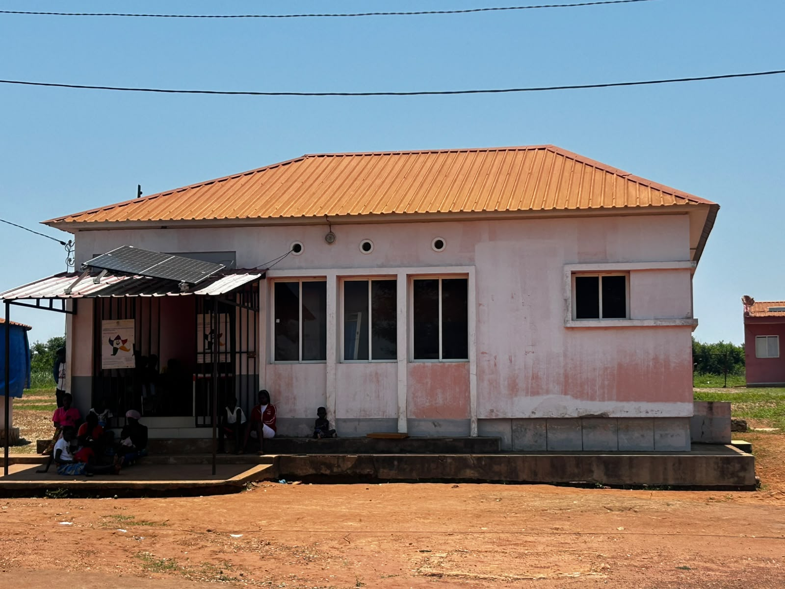

{fig-alt="Unidade sanitária rural em Angola: edifício térreo de telhado alaranjado, com painel solar sobre o alpendre e utentes à espera à sombra." .capa-foto}

::: {.capa-autores}
**Autores**

Este trabalho é realizado pela equipa do GEPE/MINSA com apoio da OMS Angola.
:::

Este documento apresenta a proposta de revisão da **Ficha de Cadastramento de Unidades Sanitárias** do Mapa Sanitário de 2019, na forma em que será aplicada: como formulário.

| Para começar | |
|---|---|
| [Nota de apresentação](apresentacao.qmd) | O que é este documento, como ler um quesito e as convenções do formulário |
| [Orientações aos revisores](revisores.qmd) | O que se pede a cada revisor e como enviar comentários |
| [Sobre o formulário](formulario.qmd) | As 19 secções do formulário, com ligação a cada uma |
